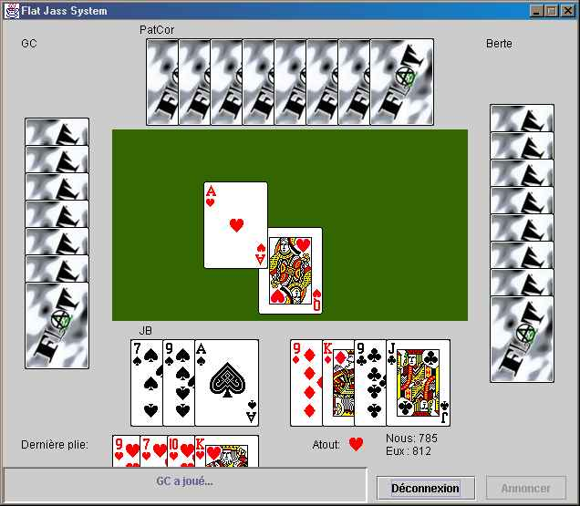
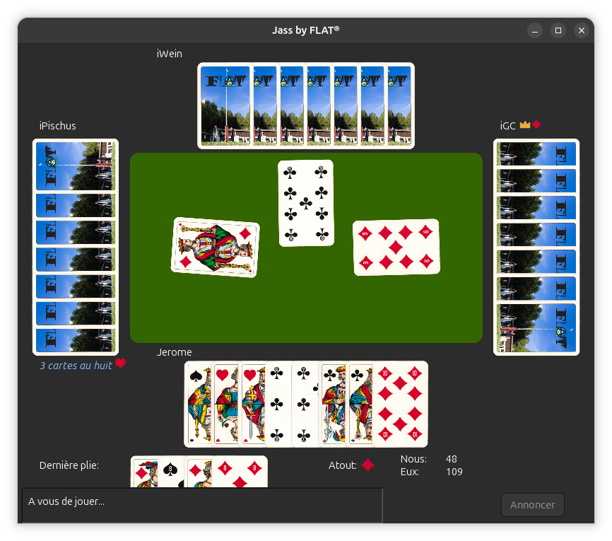
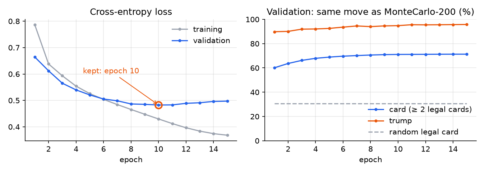
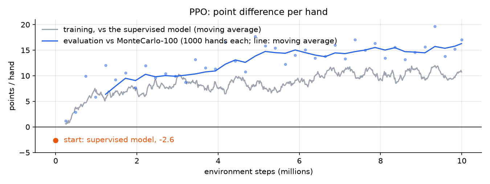

# jass
 

Distributed [Jass](https://en.wikipedia.org/wiki/Jass) game for the members of the FLAT(r)

## How to compile?
Make sure `JAVA_HOME` is defined. Then:

`mvn package`

> [!NOTE]
> If you experience any issue with the unit tests, you can skip them with `mvn package -DskipTests` .

## How to run?
- Compile the code as described above. You'll obtain a `.jar` file in `./target/`.
- Launch the client with `java -jar target/jass-2.1.3-SNAPSHOT.jar`
- Launch the server with `java -cp target/jass-2.1.3-SNAPSHOT.jar com.leflat.jass.server.JassServer`

If you make the jar file executable, you can double-click on the file to launch the client.

## How to run on Windows
The game uses Java 11. Unfortunately, Oracle abandoned the JRE
starting from version 11. You will need to install the
[full JDK](https://www.oracle.com/java/technologies/javase-jdk14-downloads.html#license-lightbox).

### Classic UI

### Modern UI

## The AI player: JassFormer

The computer players use **JassFormer**, a transformer that reads a tokenized view of the game and picks the card to play (or the trump suit). It's trained in two stages:
1. It learns to imitate a Monte Carlo player.
2. It improves by reinforcement learning (PPO), playing against copies of itself: a first round (`jassformer-v1`), then a second one starting from it (`jassformer-v2`, the client's AI).

It runs in Java with ONNX Runtime. To reproduce the training, see [TRAIN.md](TRAIN.md).

**The Monte Carlo player** (`MonteCarloStrategy`), the previous AI and the teacher here:
- **Card choice:** for each legal card, it deals the unseen cards at random (consistent with what it knows) and plays the hand out `10 × strength` times. It then plays the card with the best average result.
- **Trump choice:** the same, with `5 × strength` playouts per card in hand and suit.
- **Strength:** MonteCarlo-1000 was the AI of the client before JassFormer. Lower strengths are faster and weaker.

### Input: 96 tokens

Each decision is encoded as a fixed-length sequence of 96 tokens, from a vocabulary of 128.
- **Players are relative to the one deciding** (self, partner, left opponent, right opponent), so a single model plays every seat.
- **Scores are bucketed:** hand scores by 10 points, match scores by 100.
- **The same encoding exists twice:** in Java (`GameView`, `Tokens.java`) and in Python (`rl/tokens.py`). The two must stay identical.

| Positions | Section | Content |
|---|---|---|
| 0 | `CLS` | Its output vector feeds the heads |
| 1–9 | Globals | Decision type (card or trump), how trump was chosen (first choice or passed), who chose it, trump suit, both teams' hand scores and match scores |
| 10–19 | Hand | The player's cards, sorted, padded to 9 |
| 20–26 | Current trick | Up to 3 (player, card) pairs |
| 27–67 | History | The completed tricks: 4 cards and the winning team each (8 × 5 tokens) |
| 68–95 | Belief | For each other player, up to 4 (card, confidence) pairs: cards known from announcements (confidence 1), then the most likely cards, given who failed to follow suit, with confidence in tenths |

### Model

| | |
|---|---|
| Architecture | Transformer encoder: 6 layers, d = 256, 8 heads, feed-forward 1024, GELU, learned positional embeddings |
| Heads (on `CLS`) | Card logits (36), trump logits (4 suits + pass), and a value head used only by PPO |
| Illegal moves | Masked before the softmax |
| Size | 4.8M parameters; ONNX file of 20 MB |

### Stage 1: imitating Monte Carlo

- **Data:** `TokenExtractor` plays 6,000 games with four MonteCarlo-200 players and records every decision of every seat: 2.13M samples, 5% held out for validation.
- **Training:** cross-entropy on Monte Carlo's move. AdamW at 3e-4 with cosine decay, batch size 512, 15 epochs.
- **Model kept:** epoch 10, which has the lowest validation loss. After that the model overfits.

- **Accuracy:**
  - **Cards:** when there's a real choice (2 or more legal cards), the model plays Monte Carlo's card 71% of the time, where a random legal card would match 31% of the time.
  - **Trump:** it matches Monte Carlo's suit 95% of the time.
- **Why the card accuracy stops at 71%:** Monte Carlo's choices are noisy, since it estimates each card from a limited number of random playouts. So 100% isn't the target.
- **Result:** this model scores −2.6 points per hand against MonteCarlo-100. It's close, but it doesn't reach its teacher yet.

### Stage 2: reinforcement learning (PPO)

- **Episodes:** one hand, starting from a score of 0–0. The agent plays one seat; each of the other three seats is played by the supervised model (95%) or by a snapshot of the agent (5%), refreshed every 15 iterations. 64 games run in parallel, and the opponents' moves are batched on the GPU.
- **Reward:** after each of the agent's moves, the change in the point difference between the two teams, divided by 157. The return is therefore the hand's final point difference divided by 157, including announcements, the last trick and the match bonus. γ = 1, GAE λ = 0.95.
- **Start:**
  - The policy starts from stage 1.
  - The value head starts random, so for the first 200k steps only the value head trains: the transformer and the policy heads are frozen.
- **PPO settings:**

  | Setting | Value |
  |---|---|
  | Training length | 10M steps |
  | Batch | 16,384 steps (64 games × 256 steps) |
  | Updates per batch | 4 epochs of 8 minibatches |
  | Clipping | 0.2 |
  | Learning rate | 3e-5 for the policy, 1e-4 for the value head, both decaying linearly to 0 |
  | Entropy bonus | 0.01 |
  | Early stopping | when the approximate KL divergence exceeds 0.01, checked before each minibatch |

- **The batch size matters most:** the cards dealt cause most of the variance in a hand's result. With batches of 2,000 steps, the policy drifted. Batches of 16k steps made training stable.

What the curves show:
- **Against its teacher**, the gain levels off at about +10 points per hand, measured during training.
- **Against MonteCarlo-100**, the gain keeps rising, from −2.6 for the supervised model to about +15 from 5M steps on. The final model scores +17.1 points per hand and wins 58% of hands on these deals, used for every checkpoint during training; see below for new deals.
- So the model learned to play better in general, not only to exploit its teacher's weaknesses.

### Second round of PPO (`jassformer-v2`)

The second round starts from v1, with the trained value head, so there is no warmup.
- **Opponents:** for each hand, one model plays the three other seats.
  - In half of the hands, a fixed opponent: the supervised model or v1.
  - In the other half, one of the agent's last 8 snapshots (one taken every 15 iterations).
- **Settings:** the same as the first round, except a learning rate of 1.5e-5 for the policy, half of the first round's, and 10M steps again.
- **Results:**
  - **Against v1:** about +4.5 points per hand from 1.5M steps until late in the run. It rose to about +8 at the end, when the learning rate approached 0, as in the first round.
  - **Hands won stay at 50% against v1:** the gain is in the points, mostly on the hands that are worth a lot (matches, spades, announcements).

### Evaluation

`AiTester` measures one strategy against another in duplicate:
- **Same deals:** each deal is played twice, with the teams swapping seats, which cancels most of the luck of the cards.
- **Results:** the point difference per hand and the share of hands won, each with a 95% confidence interval.
- **Same deals for every model:** `python -m rl.evaluate` exports checkpoints to ONNX and runs AiTester on the same fixed deals for every model, against Monte Carlo strengths or other models.

`jassformer-v1`, on deals not used during training (seed 2):

| Opponent | Hands | Points per hand (95% CI) | Hands won (95% CI) |
|---|---|---|---|
| MonteCarlo-100 | 2000 | +14.1 [+11.0, +17.2] | 55.4% [53.9%, 56.9%] |
| MonteCarlo-300 | 2000 | +13.1 [+10.1, +16.1] | 55.9% [54.4%, 57.3%] |
| MonteCarlo-1000 (the previous AI) | 500 | +14.2 [+7.8, +20.6] | 57.2% [54.6%, 59.8%] |
| Supervised model (stage 1) | 2000 | +17.4 [+14.0, +20.7] | 56.3% [54.7%, 57.8%] |

`jassformer-v2` (the client's AI):

| Opponent | Hands | Points per hand (95% CI) | Hands won (95% CI) |
|---|---|---|---|
| MonteCarlo-100 (seed 2) | 2000 | **+19.3** [+16.1, +22.4] | 56.6% [55.1%, 58.1%] |
| `jassformer-v1` (seed 1) | 1000 | **+7.7** [+4.3, +11.1] | 50.3% [48.7%, 51.9%] |

More playouts don't help Monte Carlo against this model: its weakness is structural. Each playout is played as if every player could see all the cards, so Monte Carlo can't value hiding information or reading the other players, and more playouts don't change that.

## Development

- Compile and test: `mvn package`
- Compile without tests: `mvn -Dmaven.test.skip=true package`
- Update dependencies: `mvn versions:use-latest-releases`
- Create new release: `mvn release:prepare` and `mvn release:perform`
